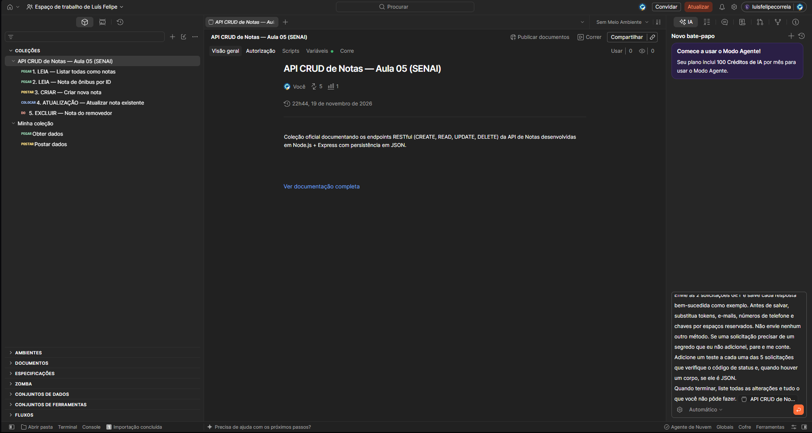
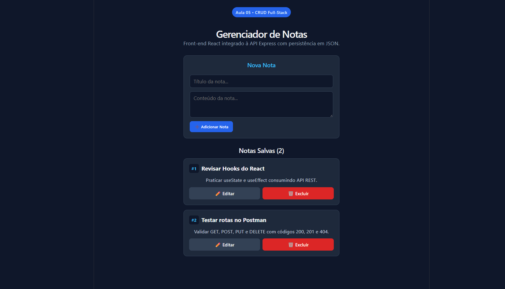
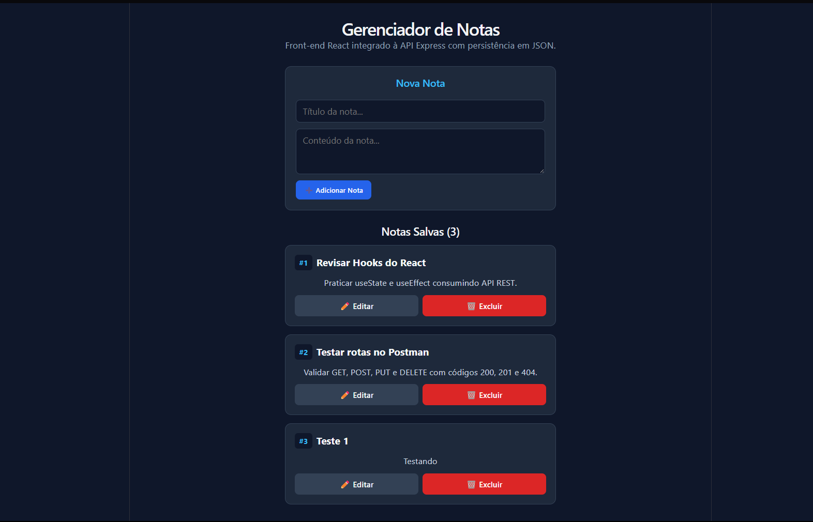
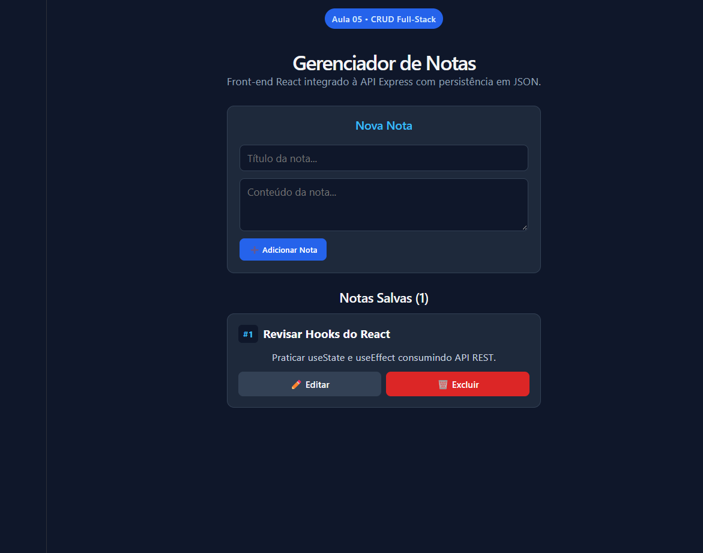
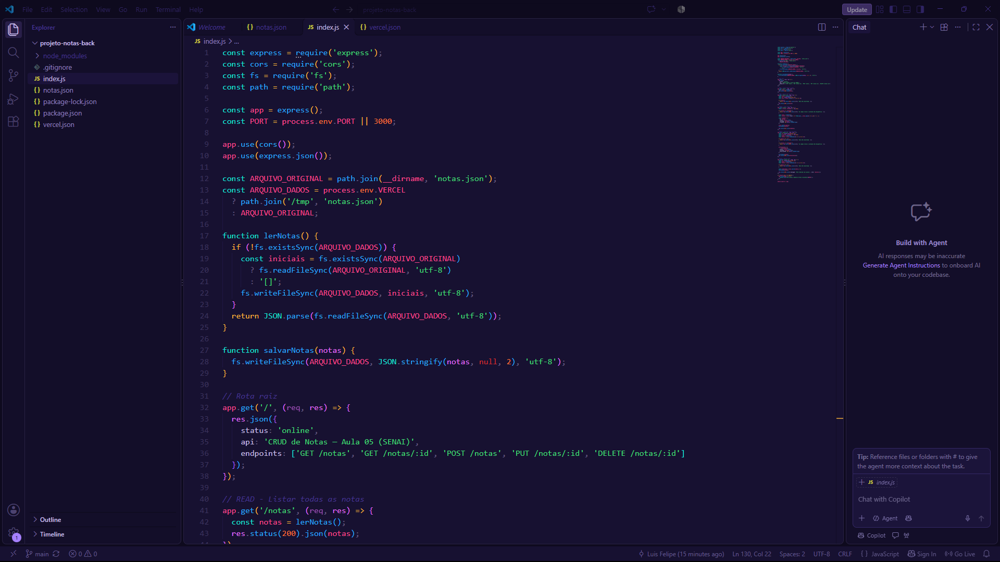
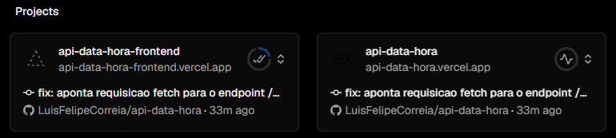

# Aula 05 — Criando APIs para o Front-end

##  Resumo da Aula

Nesta aula foi desenvolvido o ciclo completo de criação, persistência, documentação e consumo de uma API RESTful:

* **Arquitetura REST e CRUD:** implementação das quatro operações fundamentais (`POST` para criar, `GET` para ler, `PUT` para atualizar e `DELETE` para remover).
* **Parâmetros e Corpo de Requisição:** captura de parâmetros dinâmicos de rota (`req.params.id`) e payloads JSON (`req.body`) com middleware `express.json()`.
* **Persistência em Arquivo JSON:** leitura e escrita estruturada usando o módulo nativo `fs` do Node.js.
* **Códigos de Status HTTP:** uso semântico de `200 OK`, `201 Created`, `400 Bad Request` e `404 Not Found`.
* **Documentação de APIs no Postman:** organização de coleção com variáveis de ambiente, descrição de parâmetros, exemplos de JSON e validação de respostas.

---

##  Projetos e Entregas

* **Back-end (`projeto-notas-back`):**
  * Repositório: [github.com/LuisFelipeCorreia/projeto-notas-back](https://github.com/LuisFelipeCorreia/projeto-notas-back)
  * Deploy (Vercel): [https://projeto-notas-back.vercel.app](https://projeto-notas-back.vercel.app)
* **Front-end (`front-notas`):**
  * Repositório: [github.com/LuisFelipeCorreia/front-notas](https://github.com/LuisFelipeCorreia/front-notas)
  * Deploy (Vercel): [https://front-notas-hazel.vercel.app](https://front-notas-hazel.vercel.app)
* **Coleção Postman (Exportada):**
  * Arquivo anexado nesta pasta: [`CRUD_Notas_Postman_Collection.json`](./CRUD_Notas_Postman_Collection.json)

---

##  Documentação dos Endpoints (CRUD)

| Operação | Método | Endpoint | Parâmetros / Body | Códigos HTTP |
| :--- | :--- | :--- | :--- | :--- |
| **Listar notas** | `GET` | `/notas` | — | `200 OK` |
| **Buscar por ID** | `GET` | `/notas/:id` | Path: `id` (number) | `200 OK`, `404 Not Found` |
| **Criar nota** | `POST` | `/notas` | Body JSON: `{ "titulo", "conteudo" }` | `201 Created`, `400 Bad Request` |
| **Atualizar nota** | `PUT` | `/notas/:id` | Path: `id` + Body JSON: `{ "titulo", "conteudo" }` | `200 OK`, `400 Bad Request`, `404 Not Found` |
| **Remover nota** | `DELETE` | `/notas/:id` | Path: `id` (number) | `200 OK`, `404 Not Found` |

---

##  Evidências (Prints)

1. **Coleção e Testes no Postman:**
   
2. **Front-end React Executando o CRUD:**
   
   
   
3. **Código da API Express (`index.js`):**
   
4. **Deploy na Vercel:**
   