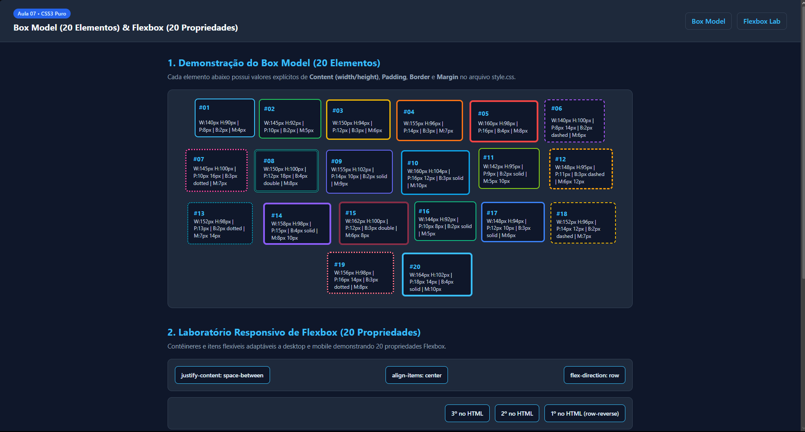
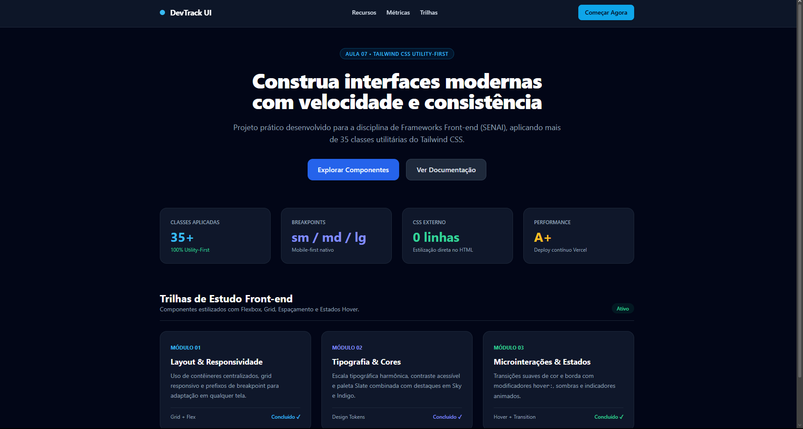

# Aula 07 — Frameworks CSS

##  Resumo da Aula

Nesta aula foram estudados os fundamentos de estilização moderna na Web, comparando a arquitetura de CSS puro (Box Model e Flexbox) com frameworks utilitários (*Utility-First*):

* **CSS Box Model:** todo elemento HTML é renderizado como uma caixa retangular composta por quatro camadas concêntricas — **Content** (`width`/`height`), **Padding** (espaçamento interno), **Border** (borda) e **Margin** (espaçamento externo), controladas por `box-sizing: border-box`.
* **Flexbox Layout:** sistema de layout unidimensional baseado em eixo principal (*main axis*) e eixo transversal (*cross axis*), permitindo alinhamento, distribuição de espaço e reorganização responsiva sem *hacks* de posicionamento.
* **Tailwind CSS (Utility-First):** framework CSS que fornece classes atômicas diretamente na marcação HTML, eliminando arquivos CSS gigantes, padronizando tokens de design (cores, espaçamentos, tipografia) e oferecendo prefixos responsivos (`sm:`, `md:`, `lg:`) e de estado (`hover:`).

---

##  Atividade 01 — CSS Puro: Box Model (20 Elementos) + Flexbox (26 Propriedades)

* **Repositório:** [github.com/LuisFelipeCorreia/projeto-css](https://github.com/LuisFelipeCorreia/projeto-css)
* **Deploy (Vercel):** [https://projeto-css-sable.vercel.app](https://projeto-css-sable.vercel.app)

### O que foi implementado (`index.html` + `style.css` externo)
1. **20 Elementos com Box Model explícito (`.box-01` a `.box-20`):** cada bloco define valores distintos de `width` e `height` (*Content*), `padding`, `border` (variando espessuras e estilos `solid`, `dashed`, `dotted`, `double`) e `margin`.
2. **26 Propriedades de Flexbox responsivas:**
   * **Contêiner Flex:** `display: flex`, `display: inline-flex`, `flex-direction: row`, `flex-direction: row-reverse`, `flex-direction: column`, `flex-direction: column-reverse`, `flex-wrap: wrap`, `flex-flow: row wrap`, `justify-content: space-between`, `justify-content: center`, `justify-content: flex-start`, `justify-content: space-around`, `justify-content: space-evenly`, `align-items: center`, `align-items: flex-start`, `align-items: stretch`, `align-content: space-between`, `gap`, `row-gap`, `column-gap`.
   * **Itens Flex:** `order`, `flex-grow`, `flex-shrink`, `flex-basis`, shorthand `flex`, `align-self: flex-end`.

---

## ⚡ Atividade 02 — Projeto com Tailwind CSS (35+ Classes Documentadas)

* **Repositório:** [github.com/LuisFelipeCorreia/projeto-tailwind](https://github.com/LuisFelipeCorreia/projeto-tailwind)
* **Deploy (Vercel):** [https://projeto-tailwind-three.vercel.app](https://projeto-tailwind-three.vercel.app)

### Lista Comentada das Classes Tailwind CSS Utilizadas (38 Classes)

#### 1. Layout, Posicionamento e Flexbox
* `flex` / `inline-block` — define contêineres flexíveis e elementos em linha com dimensões controladas.
* `flex-col` / `flex-wrap` — organiza itens em coluna vertical ou permite quebra de linha automática.
* `flex-1` — faz o elemento `<main>` expandir para ocupar todo o espaço vertical disponível.
* `items-center` / `items-end` — alinha itens no centro ou na base do eixo transversal.
* `justify-between` / `justify-center` — distribui elementos nas extremidades ou centraliza horizontalmente.
* `sticky` / `top-0` / `z-10` — fixa o cabeçalho no topo da tela durante a rolagem com camada superior.

#### 2. CSS Grid e Responsividade (*Mobile-First*)
* `grid` — ativa o sistema de grade bidimensional.
* `grid-cols-1` — define 1 coluna por padrão em telas mobile.
* `sm:grid-cols-2` — adapta para 2 colunas a partir de `640px`.
* `md:grid-cols-3` / `md:flex` / `md:text-5xl` — aplica regras específicas a partir de `768px`.
* `lg:grid-cols-4` — expande o grid de métricas para 4 colunas em telas grandes (`1024px+`).
* `hidden` — oculta a navegação desktop em telas pequenas antes do breakpoint `md:`.

#### 3. Dimensões, Espaçamento e Bordas
* `max-w-6xl` / `max-w-3xl` — limita a largura máxima dos contêineres para leitura confortável.
* `mx-auto` — centraliza blocos horizontalmente com margens automáticas.
* `min-h-screen` — garante altura mínima equivalente a `100vh`.
* `px-6` / `py-4` / `py-12` / `p-6` / `pt-2` / `pb-4` / `mt-2` — controla *padding* e *margin* na escala padronizada do Tailwind.
* `gap-3` / `gap-4` / `gap-6` / `space-y-6` / `space-y-16` — define espaçamento consistente entre filhos em Flex/Grid e pilhas verticais.
* `border` / `border-b` / `border-t` / `border-slate-800` — adiciona bordas sutis e divisórias.
* `rounded-lg` / `rounded-xl` / `rounded-2xl` / `rounded-full` — aplica raios de arredondamento progressivos até formatos circulares/pílula.

#### 4. Cores, Tipografia e Efeitos Visuais
* `bg-slate-950` / `bg-slate-900` / `bg-sky-500` / `bg-blue-600` — define cores de fundo da paleta Slate, Sky e Blue.
* `text-white` / `text-slate-100` / `text-slate-400` / `text-sky-400` / `text-emerald-400` — define hierarquia de cores de texto.
* `text-xs` / `text-sm` / `text-lg` / `text-2xl` / `text-3xl` / `text-4xl` — aplica a escala tipográfica responsiva.
* `font-medium` / `font-semibold` / `font-bold` / `font-extrabold` — controla o peso da fonte.
* `tracking-tight` / `tracking-wider` / `leading-tight` / `leading-relaxed` / `uppercase` / `antialiased` — refina espaçamento entre letras, entrelinhas e suavização de fonte.
* `backdrop-blur` / `shadow-sm` / `shadow-md` / `shadow-lg` — adiciona desfoque translúcido no header e elevação por sombras.
* `hover:text-sky-400` / `hover:bg-sky-400` / `hover:border-sky-500/50` / `transition` / `animate-pulse` — cria microinterações suaves ao passar o mouse e pulso animado no indicador de status.

---

##  Evidências (Prints)

1. **Projeto CSS Puro (`projeto-css`):**
   
2. **Projeto Tailwind CSS (`projeto-tailwind`):**
   